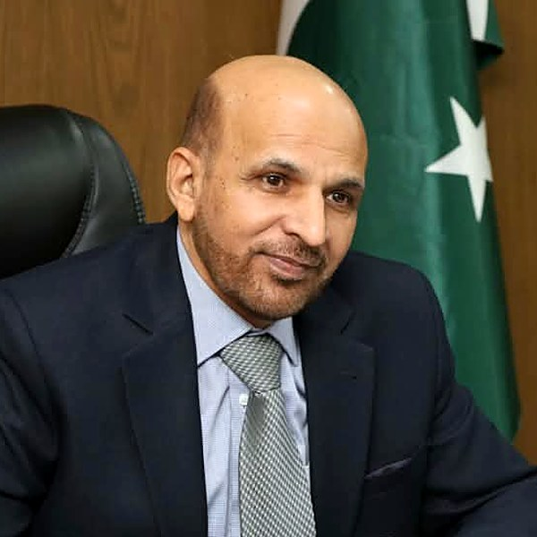

::: {.grid}
::: {.g-col-12 .g-col-md-8}

::: {.page-lead}
I am **Member (Economic Statistics) at the Pakistan Bureau of Statistics**, under the Ministry of Planning, Development and Special Initiatives, Government of Pakistan. Before joining the Bureau I spent my career at Quaid-i-Azam University, Islamabad, where I was Professor and Director of the School of Economics.
:::

:::
::: {.g-col-12 .g-col-md-4}
{fig-alt="Portrait of Zahid Asghar" style="width:100%; max-width:240px; border-bottom:4px solid #2C5F2D;"}
:::
:::

## The short story

I trained as a statistician first. After an MSc in Statistics at Bahauddin Zakariya University, Multan, I moved into economics and completed my PhD at the Pakistan Institute of Development Economics. That mix has shaped everything since: I tend to look at an economic debate and ask first where the numbers came from.

That habit led me to some of my earliest work, on the biases in Pakistan's Consumer Price Index and on how GDP and large-scale manufacturing are estimated. It also led me to spend a great deal of time teaching. Over the years I have trained a great many students, civil servants, central bankers and researchers in econometrics, R and reproducible research, because better statistics need better-equipped people on both sides: those who produce the numbers and those who use them.

In 2026 I joined the Pakistan Bureau of Statistics as Member (Economic Statistics). My portfolio covers economic statistics and, more recently, social statistics too. After many years of writing about how official statistics could be better, I now have the chance to help make them better, working with colleagues across the Bureau. Two things matter most to me here: data literacy, and the responsible use of machine learning in producing official statistics.

## Roles and positions

| Role | Institution | When |
|------|-------------|------|
| Member (Economic Statistics) | Pakistan Bureau of Statistics, Ministry of Planning, Development and Special Initiatives | 2026 to date |
| Member, Research Advisory Committee | [RASTA Competitive Grants Programme](https://rasta.pide.org.pk/research-advisory-committee/), PIDE | Current |
| Professor and Director | School of Economics, Quaid-i-Azam University | Previously |
| Registrar | Quaid-i-Azam University | Previously |
| Chairman | Department of Statistics, Quaid-i-Azam University | Previously |
| Member, technical committees | Pakistan Bureau of Statistics | Previously |
| Senior faculty | National Institute of Banking and Finance, State Bank of Pakistan | Previously |

## Education

- **PhD Economics**, Pakistan Institute of Development Economics, Islamabad
- **MSc Statistics**, Bahauddin Zakariya University, Multan

## What I work on

- **Economic measurement.** Price statistics, GDP methodology, national accounts and industrial statistics.
- **Official statistics and data infrastructure.** Economic and social statistics, machine learning in official statistics, multi-source and administrative data, and the institutions and skills a modern statistical system needs.
- **Data literacy.** Helping producers and users of statistics read, question and use data well.
- **Applied econometrics.** Causal inference, graph-theoretic causality, time series and forecasting.
- **Machine learning and statistical methods.** Penalised models for classification, new families of distributions, and outlier detection.
- **Development economics.** Food security, nutrition, health, education spending, and women's empowerment.
- **AI and data governance.** Responsible use of AI in public institutions, and the data foundations it depends on.

## Policy engagement and public writing

I write regularly for [The News](https://www.thenews.com.pk/writer/zahid-asghar) and [Daily Times](https://dailytimes.com.pk/writer/zahid-asghar/), and earlier for the [PIDE Blog](https://pide.org.pk/blog/), on data, AI and economic measurement. I have worked with the Planning Commission, the Ministry of Finance, the State Bank of Pakistan, the Federal Board of Revenue and PIDE on questions where data and policy meet, and I have trained government economists and policy officers on using AI in economic policy making. More on the [Policy & Commentary](policy.qmd) page.

## What drives my work

Pakistan makes large decisions on the basis of its official numbers: how much growth there was, how fast prices are rising, how many people are poor. Those numbers deserve the same care as the decisions they inform.

I believe three things move us forward: **better measurement** of how the economy actually works today, **better tools and skills** for the people who produce and use statistics, and **better governance** of data as AI changes how all of it is collected and used. That is what I work on, now from inside the national statistics office.

::: {.note-box}
Views expressed on this website are my own and do not represent the Pakistan Bureau of Statistics or the Government of Pakistan. For official statistics and releases, please visit [pbs.gov.pk](https://www.pbs.gov.pk/).
:::

## Contact

- **Email:** [g.zahid@gmail.com](mailto:g.zahid@gmail.com)
- **Office:** Pakistan Bureau of Statistics, 21 Mauve Area, G-9/1, Islamabad
- **LinkedIn:** [linkedin.com/in/zahid-asghar](https://www.linkedin.com/in/zahid-asghar)

[Download CV (PDF)](https://zahid.quarto.pub/cv.pdf){.btn-solid}
