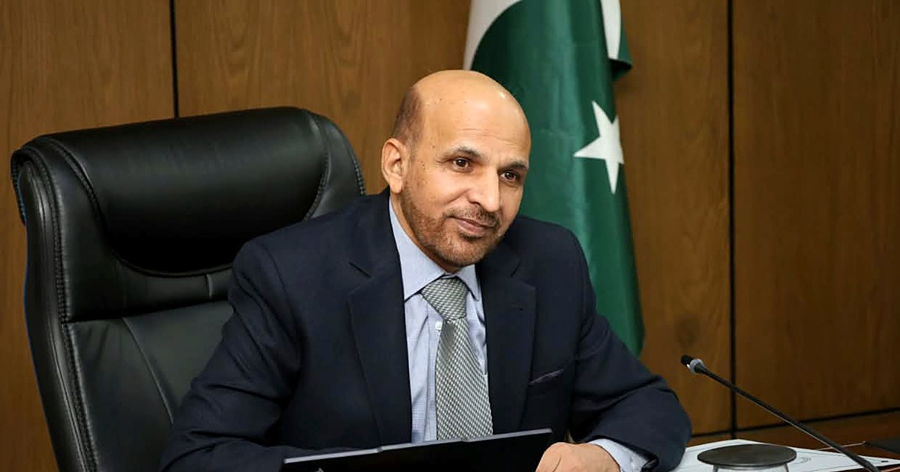

{fig-alt="Zahid Asghar at his desk at the Pakistan Bureau of Statistics, with the national flag behind him"}

I have joined the **Pakistan Bureau of Statistics** as **Member (Economic Statistics)**, under the Ministry of Planning, Development and Special Initiatives, Government of Pakistan.

In 2008 I wrote a paper on the biases in how Pakistan measured consumer prices. Since then much of my work, in research, in the classroom and in newspaper columns, has come back to the same question: how good are the numbers we use to run the country, and how can they be better? For years I asked that question from the outside. Now I have the chance to work on it from the inside, alongside colleagues who produce Pakistan's official statistics every day.

My portfolio covers economic statistics and, more recently, social statistics as well. I am excited about the work ahead, and two priorities stand out for me. The first is data literacy, both within the Bureau and among everyone who relies on its numbers. The second is bringing machine learning and new data sources into the production of official statistics, carefully and transparently.

Quaid-i-Azam University shaped most of my working life, and I am grateful to my colleagues and students there. I will keep writing and sharing open materials on this site.

*Views on this site are my own and do not represent the Pakistan Bureau of Statistics or the Government of Pakistan. For official statistics, please visit [pbs.gov.pk](https://www.pbs.gov.pk/).*
